Full-stack developer and apprentice trainer at [Navigate AG](https://navigate.de) in Karlsruhe.
I started out as an apprentice myself, have worked as a developer ever since and hold the German trainer certification (AEVO).

I build Symfony and Laravel applications, CMS-driven portals and progressive web apps, with Svelte and Vue on the front and REST APIs, data imports, charts and document pipelines behind them.
More and more of that work involves LLMs: retrieval-augmented chat on PostgreSQL and guardrails that keep the model on topic.
I also own the parts nobody sees: CI pipelines, static analysis, deployments and documentation.

### About me, as a `composer.json`

```json
{
    "name": "ferkert/ferkert",
    "description": "Full-stack developer and apprentice trainer from Karlsruhe",
    "type": "human",
    "require": {
        "php": "^7.0 || ^8.0",
        "symfony/framework-bundle": "^3.4 || ^4.4 || ^7.4 || ^8.1",
        "laravel/framework": "^10.0",
        "doctrine/orm": "^2.0 || ^3.0",
        "contao/core-bundle": "^4.13 || ^5.0"
    },
    "require-dev": {
        "phpstan/phpstan": "^2.0",
        "larastan/larastan": "^2.9",
        "rector/rector": "^2.0",
        "phpunit/phpunit": "^10.5"
    },
    "suggest": {
        "dependencytrack/dependency-track": "Knowing what is inside the software I ship",
        "mintplex-labs/anything-llm": "Self-hosted LLM experiments"
    },
    "config": {
        "editor": ["phpstorm", "vscode"],
        "shell": "fish",
        "pair-programmer": "claude-code"
    },
    "extra": {
        "career": ["apprentice", "developer", "apprentice trainer"],
        "certification": "AEVO"
    }
}
```

### What I work on

- **Symfony applications** from Symfony 3.4 on PHP 7.0 up to Symfony 8.1 on PHP 8.5, with Doctrine, Messenger, Security, Forms and Twig
- **Laravel applications** on Laravel 10 with Sanctum, queued jobs, notifications, Fractal transformers and a Vue 3 frontend built with Vite
- **AI features**: a RAG chatbot in plain PHP that chunks PDFs, stores 1024-dimensional embeddings in PostgreSQL with pgvector and an HNSW index, answers through an OpenAI-compatible model API and runs an LLM guard on both the question and the reply; plus self-hosted LLM experiments with AnythingLLM
- **CMS-driven portals** on Contao 5.7, TYPO3, WordPress and Weblication: Contao sites assembled from dozens of in-house bundles served from a private Composer repository, with versioned REST and JSON APIs, RSS feeds, AMP pages, sitemaps and a connector that plugs Laravel into Weblication
- **Svelte frontends**: Svelte 5 and TypeScript components inside Contao, built with Webpack Encore, for product configurators, calculators and form fields with input masking; a shared Svelte component library covered by Playwright component tests
- **Vue apps and PWAs**: an installable event app with Vue 3, TypeScript, Pinia, Vue Router and Tailwind CSS, with service worker, map and distance view, fed by a Symfony 7.4 JSON API with automatic cache invalidation; a search portal frontend with Vue 3, Vuex, autocomplete against an OpenAPI-described search API, D3.js knowledge maps and a Vite multi-page build with Handlebars partials
- **Market data and charts**: intraday, end-of-day and historical data pulled from external APIs, streamed over WebSockets with Node.js and turned into time-series charts
- **Data from many sources**: MariaDB, MySQL, PostgreSQL and SQL Server, sometimes all in one application
- **Document generation**: PDFs, spreadsheets and office files built with XSLT, mPDF, PhpSpreadsheet and LibreOffice
- **Quality gates in CI**: PHPStan, Larastan, Rector, PHP-CS-Fixer, PHP_CodeSniffer, PHPMD, PHPUnit, ESLint, Stylelint, Prettier, vue-tsc and security audits on every merge request
- **Shipping and docs**: GitLab CI, GitHub Actions, Docker, DDEV and Ansible; documentation as code with AsciiDoc, PlantUML and Doxygen

### Toolbox

<table>
  <tr>
    <td>backend</td>
    <td>
      <a href="https://www.php.net/"></a>
      <a href="https://symfony.com/"></a>
      <a href="https://laravel.com/"></a>
      <a href="https://www.doctrine-project.org/"></a>
      <a href="https://twig.symfony.com/"></a>
      <a href="https://getcomposer.org/"></a>
      <a href="https://www.w3.org/TR/xslt-30/"></a>
      <a href="https://nodejs.org/"></a>
      <a href="https://www.openapis.org/"></a>
    </td>
  </tr>
  <tr>
    <td>ai</td>
    <td>
      <a href="https://arxiv.org/abs/2005.11401"></a>
      <a href="https://github.com/pgvector/pgvector"></a>
      <a href="https://cloud.ionos.com/managed/ai-model-hub"></a>
      <a href="https://anythingllm.com/"></a>
    </td>
  </tr>
  <tr>
    <td>cms</td>
    <td>
      <a href="https://contao.org/"></a>
      <a href="https://typo3.org/"></a>
      <a href="https://wordpress.org/"></a>
      <a href="https://www.weblication.de/"></a>
    </td>
  </tr>
  <tr>
    <td>frontend</td>
    <td>
      <a href="https://svelte.dev/"></a>
      <a href="https://www.typescriptlang.org/"></a>
      <a href="https://ecma-international.org/publications-and-standards/standards/ecma-262/"></a>
      <a href="https://vuejs.org/"></a>
      <a href="https://pinia.vuejs.org/"></a>
      <a href="https://developer.mozilla.org/en-US/docs/Web/Progressive_web_apps"></a>
      <a href="https://d3js.org/"></a>
      <a href="https://tailwindcss.com/"></a>
      <a href="https://vite.dev/"></a>
      <a href="https://getbootstrap.com/"></a>
      <a href="https://sass-lang.com/"></a>
      <a href="https://symfony.com/doc/current/frontend/encore/index.html"></a>
      <a href="https://jquery.com/"></a>
    </td>
  </tr>
  <tr>
    <td>data</td>
    <td>
      <a href="https://mariadb.org/"></a>
      <a href="https://www.mysql.com/"></a>
      <a href="https://www.postgresql.org/"></a>
      <a href="https://www.microsoft.com/sql-server"></a>
    </td>
  </tr>
  <tr>
    <td>quality</td>
    <td>
      <a href="https://phpstan.org/"></a>
      <a href="https://github.com/larastan/larastan"></a>
      <a href="https://getrector.com/"></a>
      <a href="https://phpunit.de/"></a>
      <a href="https://playwright.dev/"></a>
      <a href="https://eslint.org/"></a>
      <a href="https://prettier.io/"></a>
      <a href="https://cs.symfony.com/"></a>
      <a href="https://stylelint.io/"></a>
    </td>
  </tr>
  <tr>
    <td>ops</td>
    <td>
      <a href="https://docs.gitlab.com/ci/"></a>
      <a href="https://github.com/features/actions"></a>
      <a href="https://www.docker.com/"></a>
      <a href="https://ddev.com/"></a>
      <a href="https://docs.ansible.com/"></a>
      <a href="https://www.kernel.org/"></a>
    </td>
  </tr>
  <tr>
    <td>docs</td>
    <td>
      <a href="https://asciidoc.org/"></a>
      <a href="https://plantuml.com/"></a>
      <a href="https://www.doxygen.nl/"></a>
    </td>
  </tr>
  <tr>
    <td>daily</td>
    <td>
      <a href="https://www.jetbrains.com/phpstorm/"></a>
      <a href="https://code.visualstudio.com/"></a>
      <a href="https://claude.com/product/claude-code"></a>
      <a href="https://fishshell.com/"></a>
      <a href="https://git-scm.com/"></a>
    </td>
  </tr>
</table>
